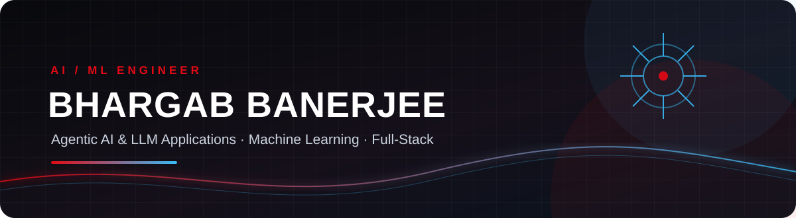

 

 

**AI/ML Engineer · Agentic AI & LLM Applications · Full-Stack Developer**

*Kolkata, India · B.Tech CSE (AI & ML), MCKV Institute of Engineering*

 

  

---

## `01` — About Me

I'm a **final-year B.Tech student in Computer Science & Engineering (AI & ML)** at MCKV Institute of Engineering, with a strong interest in building practical AI-powered products and reliable software systems.

Currently, I'm working as an **AI Expert Intern at Bengal IT Hub**, developing LLM-powered applications and full-stack product features. I also contribute to **AgaiOS**, an open-source, local-first Agentic AI Operating System.

My work and interests span LLM orchestration, multi-agent architectures, retrieval-augmented generation, machine learning, computer vision and full-stack development.

- Building practical applications with **LLMs, LangChain and LangGraph**
- Exploring **agent orchestration, model routing and AI memory systems**
- Developing backend and product functionality with **Python and PHP Laravel**
- Interested in **open source, applied research and production-focused engineering**

 

---

## `02` — Experience

<table>
<tr>
<td width="50%" valign="top">

### AgaiOS
**Open-Source Contributor · 2026–Present**

Local-first, privacy-preserving Agentic AI Operating System.

- Contributing to layered multi-agent architecture.
- Exploring model-aware routing and local LLM execution.
- Working with agent skills, MCP connectors and automation.
- Exploring vector and graph-based memory systems.

</td>
<td width="50%" valign="top">

### Bengal IT Hub
**AI Expert Intern · July 2026–Present**

- Building LLM-powered features with Python, LangChain and LangGraph.
- Applying Guardrails for output validation and safety.
- Developing full-stack functionality using PHP Laravel.
- Integrating AI capabilities into business-oriented products.

</td>
</tr>
</table>

---

## `03` — Featured Projects

<table>
<tr>
<td width="50%" valign="top">

### ✈️ Corporate Travel Management System
**PHP Laravel · GDS Integration · MySQL**

A corporate travel platform for managing business travel, travelers, bookings and trip records through centralized workflows and GDS integration.

</td>
<td width="50%" valign="top">

### 🧠 Study Buddy — AI Study Assistant
**LangChain · LangGraph · Mistral · Guardrails**

An AI study assistant that answers questions from uploaded documents, supports general study topics, and generates five-day study plans, quizzes and mock tests.

</td>
</tr>
<tr>
<td width="50%" valign="top">

### 🩸 Blood Life
**Full-Stack · Python · Telegram Bot · Mistral**

A blood donor and seeker platform connecting people directly, complemented by a conversational Telegram bot for on-the-go access.

</td>
<td width="50%" valign="top">

### 🦴 Osteoporosis Prediction & Screening
**Machine Learning · Full-Stack · Vercel**

A deployed web application that analyzes clinical patient data for early osteoporosis risk screening.

[↗ Live Application](https://osteoporosis-prediction-site.vercel.app)

</td>
</tr>
<tr>
<td width="50%" valign="top">

### 🖐️ Two-Handed Gesture Control
**Python · MediaPipe · OpenCV**

A real-time, touchless computer-vision system that uses dual-hand gestures for cursor movement and click interactions.

[↗ GitHub Repository](https://github.com/BhargabBanerjee/HAND_GESTURE_CURSOR)

</td>
<td width="50%" valign="top">

### 🚘 BLINK SHIFT
**Artificial Intelligence · Computer Vision**

An AI-based automatic turn-signal system designed to detect driver intent. Qualified for the final round of MCKVIE Nurturing Innovation.

</td>
</tr>
<tr>
<td width="50%" valign="top">

### 🏦 ATM Management System
**Python · MySQL**

A console-based banking application supporting deposits, withdrawals, transfers and balance checks.

[↗ GitHub Repository](https://github.com/BhargabBanerjee/ATM-MACHINE)

</td>
<td width="50%" valign="top">

### More in Progress
**Learning · Building · Experimenting**

Continuously exploring applied AI, LLM applications, machine learning and software engineering through hands-on projects.

</td>
</tr>
</table>

---

## `04` — Technical Stack

### AI / Machine Learning

`LangChain` · `LangGraph` · `Guardrails` · `Ollama` · `Scikit-learn` · `Pandas` · `NumPy` · `MediaPipe` · `MCP` · `LLM Orchestration`

### Languages

### Backend, Database & Tools

`REST APIs` · `GDS API Integration` · `Claude Code` · `Codex`

### Generative AI Ecosystem

`ChatGPT` · `Gemini` · `Claude` · `DeepSeek` · `Mistral` · `Ollama`

---

## `05` — GitHub Analytics

 

  

 

---

## `06` — Achievements & Recognition

| Recognition | Details |
|:--|:--|
| 🥇 Best Abstract | 1st Place — MCKVIE Research Symposium |
| 🥈 Best Presenter | 2nd Place — MCKVIE Research Symposium |
| 🔬 Research | AI-Based Bengali Mathematical Reasoning System using Multilingual Transformers |
| 🚀 Innovation | Final Round Qualifier — MCKVIE Nurturing Innovation (BLINK SHIFT) |
| 🌐 Hackathon | Participant — Infosys Global Hackathon 2025 |
| 📜 Certifications | Infosys Springboard — NLP, Artificial Intelligence and Data Science |

---

## `07` — Education

**B.Tech — Computer Science & Engineering (Artificial Intelligence & Machine Learning)**

MCKV Institute of Engineering · Expected 2027

---

## `08` — Beyond the Code

When I'm not building software, I enjoy exploring emerging technologies, following developments in AI, listening to music, singing, watching movies and travelling.

---

## `09` — Let's Connect

Have an interesting idea, an AI project, an open-source opportunity or a reason to collaborate? Let's connect.

  

# BhargabBanerjee
