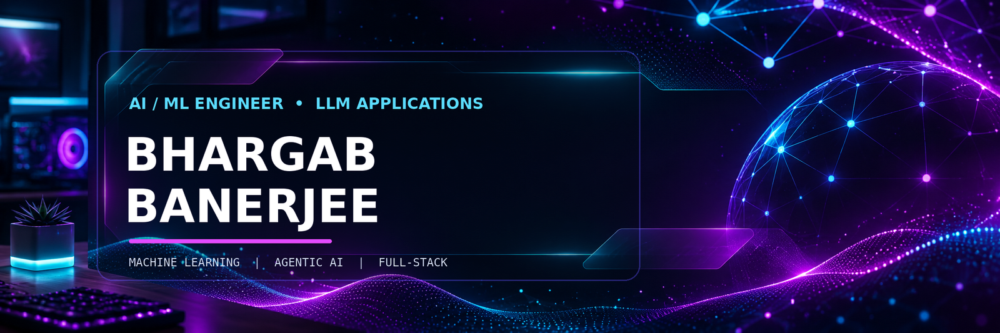
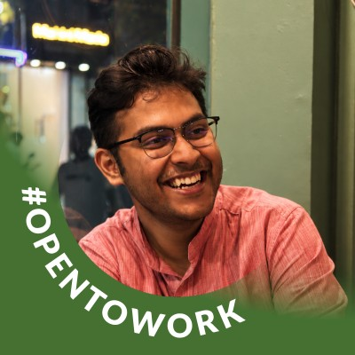

 

 

---

<table>
<tr>
<td width="64%" valign="middle">

## `01` &nbsp; SYSTEM PROFILE

### Hey, I'm Bhargab.

**AI/ML Engineer · LLM Applications · Full-Stack Developer**

I'm a final-year B.Tech student in Computer Science & Engineering (AI & ML) at **MCKV Institute of Engineering**, currently working as an **AI Expert Intern at Bengal IT Hub**.

I build practical software at the intersection of AI and product engineering — from LLM-powered applications and computer-vision systems to full-stack platforms using Python and PHP Laravel.

**Currently focused on:** LLM orchestration, RAG, agentic workflows, applied machine learning, computer vision and dependable product engineering.

</td>
<td width="36%" align="center" valign="middle">

**Kolkata, India**

`B.Tech CSE — AI & ML`

`Expected 2027`

</td>
</tr>
</table>

## `02` &nbsp; LIVE DEVELOPER SNAPSHOT

<table>
<tr>
<td align="center" width="33%">

**16**

Repositories

</td>
<td align="center" width="33%">

**6**

Stars

</td>
<td align="center" width="33%">

**4**

Followers

</td>
</tr>
</table>

Public profile snapshot checked on 6 November 2026. GitHub counts can change over time.

## `03` &nbsp; EXPERIENCE

<table>
<tr>
<td width="50%" valign="top">

### ◈ Bengal IT Hub
**AI Expert Intern · Jul 2026 — Present**

- Develop LLM-powered features with Python, LangChain and LangGraph.
- Apply Guardrails for output validation and safety.
- Build full-stack product functionality using PHP Laravel.
- Integrate AI capabilities into business-oriented applications.

</td>
<td width="50%" valign="top">

### ◈ AgaiOS
**Open-Source Contributor · 2026 — Present**

- Contribute to a local-first Agentic AI Operating System.
- Explore multi-agent orchestration and model-aware routing.
- Work with MCP connectors, agent skills and automation.
- Explore vector and graph-based memory architectures.

</td>
</tr>
</table>

## `04` &nbsp; FEATURED BUILDS

<table>
<tr>
<td width="50%" valign="top">

### 01 / Corporate Travel Management System

**PHP Laravel · MySQL · GDS Integration**

Corporate travel platform for managing business travel, traveler records, bookings and trip workflows through centralized organizational controls.

`BACKEND` `TRAVEL TECH` `INTEGRATION`

</td>
<td width="50%" valign="top">

### 02 / Study Buddy

**LangChain · LangGraph · Mistral · Guardrails**

AI study assistant with document-grounded question answering, five-day study plans, topic-wise quizzes and mock tests.

`LLM APPLICATION` `RAG` `EDTECH`

</td>
</tr>
<tr>
<td width="50%" valign="top">

### 03 / Blood Life

**Full-Stack · Python · Telegram Bot · Mistral**

Blood donor and seeker platform connecting people directly, supported by a conversational Telegram bot for accessible donor matching.

`SOCIAL IMPACT` `AUTOMATION` `WEB`

</td>
<td width="50%" valign="top">

### 04 / Osteoporosis Screening

**Machine Learning · Full-Stack · Vercel**

Deployed web application that analyzes clinical patient data for early osteoporosis risk screening.

[↗ Open live application](https://osteoporosis-prediction-site.vercel.app)

`HEALTHCARE ML` `DEPLOYED`

</td>
</tr>
<tr>
<td width="50%" valign="top">

### 05 / Two-Handed Gesture Control

**Python · MediaPipe · OpenCV**

Real-time touchless computer-vision system using dual-hand gestures for cursor movement and click interactions.

[↗ View HAND_GESTURE_MOUSE](https://github.com/BhargabBanerjee/HAND_GESTURE_MOUSE)

`COMPUTER VISION` `REAL-TIME`

</td>
<td width="50%" valign="top">

### 06 / BLINK SHIFT

**Artificial Intelligence · Computer Vision**

AI-based automatic turn-signal system designed to detect driver intent. Qualified for the final round of MCKVIE Nurturing Innovation.

`INNOVATION` `AI SYSTEM`

</td>
</tr>
<tr>
<td width="50%" valign="top">

### 07 / ATM Management System

**Python · MySQL**

Console-based banking application supporting deposits, withdrawals, transfers and balance checks.

[↗ View ATM-MACHINE](https://github.com/BhargabBanerjee/ATM-MACHINE)

`DATABASE` `PYTHON`

</td>
<td width="50%" valign="top">

### 08 / BHARGAB.DEV

**HTML · Tailwind CSS · JavaScript**

Responsive personal portfolio website created to showcase projects, skills and achievements.

[↗ View repository](https://github.com/BhargabBanerjee/BHARGAB.DEV)

`WEB DEVELOPMENT` `PORTFOLIO`

</td>
</tr>
</table>

## `05` &nbsp; TECH STACK

**AI / ML · LLM APPLICATIONS**

`LangChain` &nbsp; `LangGraph` &nbsp; `Guardrails` &nbsp; `Ollama` &nbsp; `Scikit-learn` &nbsp; `Pandas` &nbsp; `NumPy` &nbsp; `MediaPipe` &nbsp; `MCP`

 

**LANGUAGES**

 

**BACKEND · DATABASE · DEVELOPER TOOLS**

 

**GENERATIVE AI ECOSYSTEM**

`ChatGPT` &nbsp; `Gemini` &nbsp; `Claude` &nbsp; `DeepSeek` &nbsp; `Mistral` &nbsp; `Ollama`

## `06` &nbsp; GITHUB TELEMETRY

  

  

  

## `07` &nbsp; RESEARCH & RECOGNITION

<table>
<tr><td>🥇 **1st Place — Best Abstract**</td><td>MCKVIE Research Symposium</td></tr>
<tr><td>🥈 **2nd Place — Best Presenter**</td><td>MCKVIE Research Symposium</td></tr>
<tr><td>🔬 **Research Work**</td><td>AI-Based Bengali Mathematical Reasoning System using Multilingual Transformers</td></tr>
<tr><td>🚀 **Final Round Qualifier**</td><td>MCKVIE Nurturing Innovation — BLINK SHIFT</td></tr>
<tr><td>🌐 **Hackathon Participant**</td><td>Infosys Global Hackathon 2025</td></tr>
<tr><td>📜 **Certifications**</td><td>Infosys Springboard — NLP, AI and Data Science</td></tr>
</table>

## `08` &nbsp; EDUCATION

**B.Tech — Computer Science & Engineering (Artificial Intelligence & Machine Learning)**

MCKV Institute of Engineering · Expected 2027

## `09` &nbsp; CONNECT / COLLABORATE

Open to meaningful conversations around AI engineering, LLM applications, full-stack product development and open-source collaboration.

  

